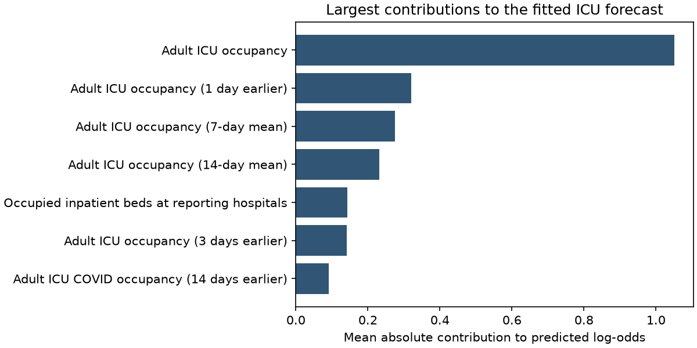

# Can current hospital reports warn of an ICU capacity breach?

This project ranks state-level hospital reports by the likelihood that **adult ICU occupancy will reach 90% on at least one of the next seven days**. The reproducible case study uses a historical U.S. Department of Health and Human Services snapshot and compares an XGBoost classifier with the simplest operational benchmark, today's occupancy.

**Held-out result.** Across 18,630 forecast dates and jurisdictions, the model achieved 0.391 average precision against 0.372 for occupancy persistence. At a fixed 0.5 probability threshold, the model detected 52 of 376 positive forecast origins and produced six false alerts. Persistence detected 78 and produced 33 false alerts. This trade-off matters more for alert design than an isolated accuracy figure.

[Read the executed analysis](covid_analysis.ipynb) · [Inspect the model and evaluation](icu_forecast.py) · [Review the model card](docs/model-card.md)

## Run the analysis

Use Python 3.12 and uv. The checked-in dataset and resolved dependencies support a CPU run without API keys. From a clone of this repository, run the following commands.

```sh
uv sync --locked --python 3.12
uv run --no-sync python icu_forecast.py --output-dir results
uv run --no-sync python -m unittest discover -s tests -v
```

The command prints three methods on the same test origins and writes `icu_breach_probabilities.csv` plus `SHAP_features.png` to the selected directory. The displayed notebook uses the same functions. To rerun it from a clean kernel, run the following commands from the repository root.

```sh
uv sync --locked --extra notebook --python 3.12
uv run --no-sync jupyter nbconvert --to notebook --execute --output covid_analysis.nbconvert.ipynb covid_analysis.ipynb
```

Notebook execution regenerates the two root result files. The installation and run were verified on Windows x64 with CPython 3.12.11.

## What the comparison measures

| Method | ROC AUC | Average precision | Brier score | Correct alerts | False alerts | Missed breaches |
|---|---:|---:|---:|---:|---:|---:|
| Training event rate | 0.5000 | 0.0202 | 0.0208 | 0 | 0 | 376 |
| Occupancy persistence | 0.8428 | 0.3717 | 0.0178 | 78 | 33 | 298 |
| XGBoost | 0.9308 | 0.3912 | 0.0154 | 52 | 6 | 324 |

Test origins span July 1, 2022 through June 10, 2023. The model fits the training period and selects its tree count on a separate validation period. Each training and validation outcome window ends before the next partition starts. A complete future week is required for every evaluated origin.

The snapshot contains 54 states and reporting jurisdictions. Hospital participation and reporting dates vary. Outcomes expose repeated days within the same event, and publication lags in this historical export are unknown. The scores describe retrospective discrimination and forecast error. The study does not establish clinical utility.



The original project established the XGBoost ICU forecast, cutoff date, ratio features, explanatory plot and prediction export. This revision repairs state-day alignment and outcome windows, adds a separate model-selection period and benchmarks, and regenerates the historical outputs. The upstream HHS dataset is listed as a U.S. government work. [Snapshot provenance and field definitions](data/README.md) · [HHS catalog](https://catalog.data.gov/dataset/covid-19-reported-patient-impact-and-hospital-capacity-by-state-timeseries-raw)
